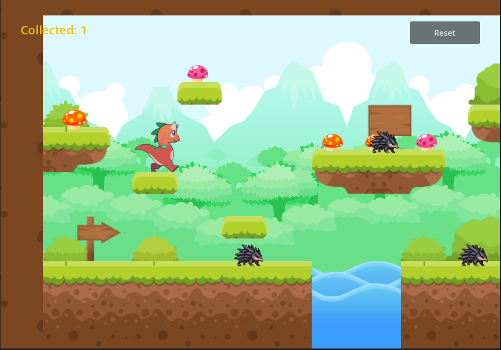
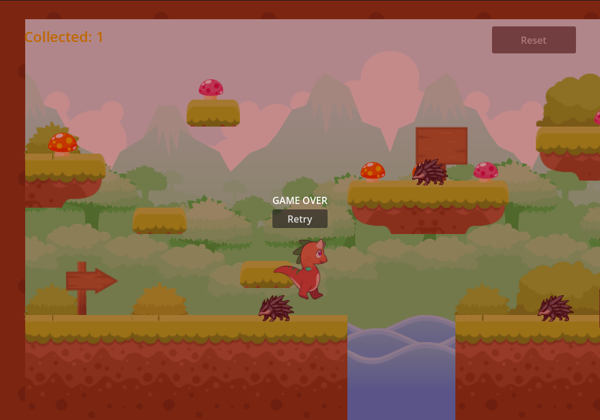

# Dino Platformer


A compact 2D platformer built with **Godot 4.7**. Guide a dinosaur across floating platforms, grab mushrooms and crates, dodge patrolling porcupines, and don't fall in the water.

| Gameplay | Game Over |
| :---: | :---: |
|  |  |

## Features

- Smooth platforming with gravity, jumping, and sprite flipping
- Animated player character: idle, running, and jumping
- Patrolling porcupine enemies that turn at fixed limits and end the run on contact
- Collectibles with a live counter in the HUD
- Kill zone for falling off the map
- Game Over overlay with Retry, plus a Reset button at any time
- Hand-built level using `TileMapLayer` and a tile atlas
- No plugins or external dependencies — open and run

## Controls

| Action | Keys |
| --- | --- |
| Move left | `A` / `Left Arrow` |
| Move right | `D` / `Right Arrow` |
| Jump | `W` / `Space` / `Up Arrow` |
| Reset level | `Reset` button (top right) |
| Retry after game over | `Retry` button |

## Getting Started

**Requirements:** Godot **4.7 or newer** (tested with 4.7.1, Forward+ renderer). Older 4.x versions cannot open this project without upgrading it.

```bash
git clone https://github.com/Asutilla/Godot_Dino_Platfomer.git
cd Godot_Dino_Platfomer
```

1. Launch Godot 4.7+ and choose **Import**.
2. Select `project.godot` from this folder, then **Import & Edit**.
3. Wait for the assets to import on first open, then press **F5**.

Or from the command line:

```bash
godot --path . --editor   # open the editor
godot --path .            # run the game
```

> `.godot/` is a generated cache and is not committed. Godot recreates it automatically, so the first launch takes a few extra seconds.

## Project Structure

```text
.
├── project.godot          # Settings, input map, window size
├── main.tscn              # Level: tilemap, player, enemies, pickups, HUD
├── player.tscn / .gd      # CharacterBody2D controller and animations
├── enemy.tscn / .gd       # Patrolling enemy that triggers game over
├── collectible.tscn / .gd # Pickup that increments the counter
├── kill_zone.tscn / .gd   # Fall-off-the-map trigger
├── game_over.tscn / .gd   # Game Over overlay with Retry
├── docs/                  # Screenshots used in this README
└── assets/
    ├── backgrounds/
    ├── characters/        # Dino frames and porcupine
    ├── collectibles/
    ├── objects/           # Bushes, trees, signs, stones, props
    └── tilesets/          # 18 terrain tiles
```

### How it works

- **`player.gd`** applies gravity when airborne, reads the `move_left` / `move_right` axes, jumps only while grounded, and switches animations based on state.
- **`enemy.gd`** walks between `start_x ± patrol_distance` and flips its sprite to face the walking direction.
- **`collectible.gd`** calls `collect_item()` on any body that supports it, then frees itself.
- **`kill_zone.gd`** and **`enemy.gd`** both call `show_game_over()` on the level's `GameOver` node.
- **`game_over.gd`** pauses the player, shows the overlay, and reloads the scene on Retry.

## Customizing

| What | Where |
| --- | --- |
| Player speed / jump height | `player.gd` → `speed`, `jump_velocity` |
| Enemy speed / patrol range | `enemy.gd` → `speed`, `patrol_distance` |
| Window size | `project.godot` → `display/window/size` |
| Key bindings | **Project → Project Settings → Input Map** |
| Level layout | `main.tscn` → paint on the `GroundTiles` layer |
| Pickup appearance | `collectible.tscn` → `item_texture` on each instance |

## Credits

- **Art:** free 2D platformer tileset pack — *replace with the pack's name and author link.*
- **Engine:** [Godot Engine](https://godotengine.org) (MIT License)

If the tileset license requires attribution, add it here before distributing this project.

## License

This project is shared for learning and demo purposes. Add a `LICENSE` file if you intend to redistribute it. Art assets remain under the tileset pack's original license.
